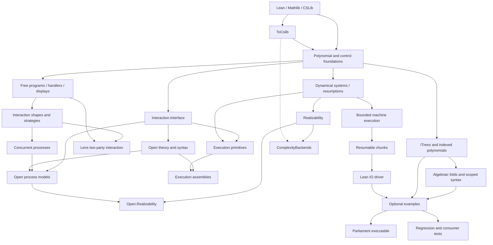

# Repository map

The repository contains several Lake libraries. Dependencies flow from shared
foundations into specialized interpretations. Choose an import by the concept
it provides, rather than importing the whole project while developing a module.

## Library targets

| Target | Purpose | Build or import |
|---|---|---|
| `PolyFun` | Generic polynomial, interaction, logic, and realizability library, with measure interpretations of its constructions | Default `lake build`; `import PolyFun` or a specific module |
| `ToCslib` | Upstream staging: free-monad and loop laws, order bridge, omega-CPO fixed points, finite case compilation, `Fin`-indexed monadic sequencing, bitvector, polynomial, measure and kernel lemmas | `lake build ToCslib`; specific `ToCslib.*` imports |
| `ComplexityBackends` | Optional concrete complexity backends, one subdirectory per machine model | `lake build ComplexityBackends`; `import ComplexityBackends` or a specific `ComplexityBackends.CslibSingleTape.*` module |
| `PolyFunExamples` | Checked tutorials, the Parliament application, and typed console forms and checked filesystem operations (`Examples/IO/`) under `Examples/` | `lake build PolyFunExamples`; `import Examples.Tutorials.Requests` |
| `PolyFunTest` | Regression tests, adversarial cases, and ordinary-import consumers | `lake test` |
| `PolyFunFrontier` (nested package) | The parts of PolyFun that need cslib-frontier, at the paths they would have in PolyFun; see [its README](../../PolyFunFrontier/README.md) | `cd PolyFunFrontier && lake build PolyFunFrontier`; never imported by the libraries above |

`PolyFun.lean`, `ToCslib.lean`, and `ComplexityBackends.lean` are generated import
indexes. The optional backends and examples are outside the `PolyFun` umbrella.
`PolyFunTest` can consume examples, but production never depends on examples or tests.

`PolyFunExamples` combines tutorial globs with the generated `Examples.Parliament`
root; there is no generic `Examples` umbrella to collide with a downstream target.
`polyfun-parliament` uses the separate `PolyFunParliamentMain` executable entry point.
Example and test imports never flow back into production.

## Find the right module

| Subject | Entry point | Guide |
|---|---|---|
| Polynomial interfaces and morphisms | [PFunctor basics](../../PolyFun/PFunctor/Basic.lean), [lens laws](../../PolyFun/PFunctor/Lens/Basic.lean), [Yoneda and natural transformations](../../PolyFun/PFunctor/Lens/Yoneda.lean), [special classes](../../PolyFun/PFunctor/Equiv/Special.lean), [universal properties](../../PolyFun/PFunctor/Lens/Universal.lean), [monoidal structures](../../PolyFun/PFunctor/Category/Monoidal.lean), [factorization as morphism properties](../../PolyFun/PFunctor/Category/Factorization.lean), [cancellable lenses](../../PolyFun/PFunctor/Lens/MonoEpi.lean), [monomorphisms and epimorphisms](../../PolyFun/PFunctor/Category/MonoEpi.lean) | [Polynomial functors](../guides/pfunctor.md) |
| Free programs and handlers | [Free basics](../../PolyFun/PFunctor/Free/Basic.lean), [handlers](../../PolyFun/PFunctor/Handler.lean), [handler sums](../../PolyFun/PFunctor/Handler/Sum.lean), [exceptional answers](../../PolyFun/PFunctor/Free/Except.lean), [handler composition](../../PolyFun/PFunctor/Handler/Free.lean), [stateful combinators](../../PolyFun/PFunctor/Handler/Stateful/Combinators.lean), [stateful projections](../../PolyFun/PFunctor/Handler/Stateful/Projection.lean), [stateful packages](../../PolyFun/PFunctor/Handler/Stateful/Link.lean), [stateful lenses](../../PolyFun/PFunctor/Handler/StateLens.lean), [frame rules for stateful sums](../../PolyFun/PFunctor/Free/WP/StatefulFrame.lean) | [First program](../tutorials/first-program.md), [program logic](../guides/program-logic.md#frame-rules-for-sums-of-stateful-handlers) |
| Program-type signatures, codes, and relational lifts | [Signature derivation](../../PolyFun/PFunctor/Free/DeriveSig.lean), [codes](../../PolyFun/PFunctor/Free/Code.lean), [relations between codes](../../PolyFun/PFunctor/Free/CodeRel.lean), [cost over codes](../../PolyFun/PFunctor/Free/WP/Cost.lean), [quotients by equations](../../PolyFun/PFunctor/Free/Quotient.lean) | [Polynomial functors](../guides/pfunctor.md#signatures-of-program-types) |
| Σ, Π and pullback along maps; natural models | [Slices](../../PolyFun/PFunctor/Slice.lean), [natural models](../../PolyFun/PFunctor/NaturalModel.lean) | [Polynomial functors](../guides/pfunctor.md#signatures-of-program-types) |
| Binding syntax and type-changing IR translations | [Scoped signatures and environments](../../PolyFun/IPFunctor/Scoped/Basic.lean), [environment relations](../../PolyFun/IPFunctor/Scoped/EnvRelation.lean), [interpretations](../../PolyFun/IPFunctor/Scoped/Interpretation.lean), [continuous interpretations](../../PolyFun/IPFunctor/Scoped/DomainInterpretation.lean), [certified meanings](../../PolyFun/IPFunctor/Scoped/Certificate.lean), [syntactic logical relations](../../PolyFun/IPFunctor/Scoped/Adequacy.lean), [reindexing](../../PolyFun/IPFunctor/Scoped/Reindex.lean) | [Scoped programs](../guides/ipfunctor.md#binding-signatures-and-native-ir) |
| Binding families over parameter contexts | [Families](../../PolyFun/IPFunctor/Scoped/Family.lean), [family maps](../../PolyFun/IPFunctor/Scoped/FamilyMap.lean), [substitution](../../PolyFun/IPFunctor/Scoped/FamilySubstitution.lean), [translation/substitution laws](../../PolyFun/IPFunctor/Scoped/FamilyMapSubstitution.lean), [indexed traversals](../../PolyFun/IPFunctor/Free/Traversal.lean), [continuous environments](../../PolyFun/IPFunctor/Scoped/Domain.lean), [continuous environment relations](../../PolyFun/IPFunctor/Scoped/DomainRelation.lean) | [Parameter-context binders](../guides/ipfunctor.md#binders-that-change-parameter-contexts) |
| Two-level binding families | [Stacked families](../../PolyFun/IPFunctor/Scoped/Stacked.lean), [their interpretations](../../PolyFun/IPFunctor/Scoped/StackedInterpretation.lean) | [Two-level binding families](../guides/ipfunctor.md#two-level-binding-families) |
| Importing typed syntax with kernel acceptance | [Quotation](../../PolyFun/IPFunctor/Scoped/Import/Quote.lean), [kernel submission](../../PolyFun/IPFunctor/Scoped/Import/Submit.lean), [the import driver](../../PolyFun/IPFunctor/Scoped/Import/Driver.lean) | [Importing typed syntax](../guides/ipfunctor.md#importing-typed-syntax) |
| Represented-data contracts | [Correspondence](../../PolyFun/Control/Semantics/Correspondence.lean), [certificates for scoped syntax](../../PolyFun/IPFunctor/Scoped/Certificate.lean) | [Computation models](../guides/computation-models.md#connections-and-their-proof-boundaries) |
| Deterministic transitions | [Transitions](../../PolyFun/Control/Transition.lean), [tree and machine adapters](../../PolyFun/ITree/Transition.lean) | [Computation models](../guides/computation-models.md#connections-and-their-proof-boundaries) |
| State-dependent interfaces | [Indexed basics](../../PolyFun/IPFunctor/Basic.lean), [indexed roll bounds](../../PolyFun/IPFunctor/Free/Bound.lean), [bound transport](../../PolyFun/IPFunctor/Free/Bound/Reindex.lean), [bounds under traversals](../../PolyFun/IPFunctor/Free/Bound/Traversal.lean), [loop bounds](../../PolyFun/IPFunctor/Free/Bound/Loops.lean), [dependent tuples](../../PolyFun/IPFunctor/Free/Tuple.lean), [transport along lenses](../../PolyFun/IPFunctor/Free/Lens.lean) | [Indexed polynomials](../guides/ipfunctor.md) |
| Indexed folds, reindexing, and traversals | [Folds](../../PolyFun/IPFunctor/Free/Fold.lean), [reindexing](../../PolyFun/IPFunctor/Free/Reindex.lean), [traversals](../../PolyFun/IPFunctor/Free/Traversal.lean) | [Indexed polynomials](../guides/ipfunctor.md#folds-reindexing-and-traversals) |
| Behaviors and explicit-state machines | [Resumptions](../../PolyFun/PFunctor/Resumption.lean), [dynamical systems](../../PolyFun/PFunctor/Dynamical/Basic.lean), [automata bridges](../../PolyFun/PFunctor/Dynamical/Automata.lean), [orbits](../../PolyFun/PFunctor/Dynamical/Run.lean) and [labeled traces](../../PolyFun/PFunctor/Dynamical/Trace.lean) | [Computation models](../guides/computation-models.md) |
| Interaction trees and recursion | [ITree basics](../../PolyFun/ITree/Basic.lean) | [Interaction trees](../guides/itree.md) |
| Partial result domains | [Pointed domains](../../PolyFun/Control/Domain/Pointed.lean), [lifted results, their sequencing and transfer along decoders](../../PolyFun/Control/Domain/Result.lean), [relations and approximations between results](../../PolyFun/Control/Domain/ResultRel.lean), [prefix recurrences](../../PolyFun/Control/Domain/PrefixRecursion.lean), [lazy-language tutorial](../../Examples/Tutorials/LazyLanguages.lean) | [Continuous interpretations](../guides/itree.md#continuous-domain-interpretations) |
| Continuous tree interpretations | [Resumption domains](../../PolyFun/PFunctor/Resumption/Domain.lean), [finite approximations](../../PolyFun/PFunctor/Resumption/DomainTruncate.lean), [ITree domains](../../PolyFun/ITree/Domain.lean), [sequencing and iteration](../../PolyFun/ITree/DomainLaws.lean) | [Continuous interpretations](../guides/itree.md#continuous-domain-interpretations) |
| Least fixed points and admissible predicates | [Omega-CPO fixed points](../../ToCslib/Order/OmegaCompletePartialOrder.lean), [admissibility](../../ToCslib/Order/Admissible.lean), [prefix recursion](../../ToCslib/Order/PrefixRecursion.lean) | [Upstream ownership](../development/upstream.md#omega-cpo-fixed-points) |
| Interpreting trees into monads | [Interpretation](../../PolyFun/ITree/Interp/Defs.lean), [laws](../../PolyFun/ITree/Interp/Laws.lean), [exact stateful equations](../../PolyFun/ITree/Interp/Stateful.lean) | [Interaction trees](../guides/itree.md#interpreting-into-a-monad) |
| Running trees as machines, with silent-step handlers | [Machine](../../PolyFun/ITree/Machine.lean) | [Interaction trees](../guides/itree.md#running-a-tree-as-a-machine) |
| Iterative monads and transformer loops | [Iteration](../../PolyFun/Control/Monad/Iter.lean), [transformer instances](../../PolyFun/Control/Monad/Iter/Instances.lean) | [Interaction trees](../guides/itree.md#iterative-monads) |
| Protocol shapes and strategies | [TypeTree](../../PolyFun/Interaction/Basic/TypeTree.lean) | [Interaction](../guides/interaction.md) |
| Lens-based two-party interaction | [Signature](../../PolyFun/Interaction/TwoParty/Lens/Signature.lean), [strategies](../../PolyFun/Interaction/TwoParty/Lens/Strategy.lean), [composition](../../PolyFun/Interaction/TwoParty/Lens/Compose.lean) | [Lens interaction](../guides/interaction.md#lens-based-two-party-protocols-twopartylens) |
| Two-party, multiparty, concurrent interaction | `Interaction/TwoParty`, `Multiparty`, `Concurrent` | [Interaction](../guides/interaction.md) |
| General interfaces and directed boundaries | [Interface](../../PolyFun/Interaction/Interface.lean) | [Execution](../guides/execution.md) |
| Executable reactive/request networks | `Interaction/Execution` | [Execution](../guides/execution.md) |
| Resumable handled execution | [Chunks](../../PolyFun/PFunctor/Dynamical/DynComputation/Resumable.lean), [handled diagrams](../../PolyFun/Interaction/Execution/ReactiveNetwork/HandledDiagram.lean) | [Execution](../guides/execution.md#resumable-execution), [networks](../guides/execution.md#typed-execution-networks) |
| Activation budgets and work conservation | [Budget](../../PolyFun/Interaction/Execution/ReactiveNetwork/Budget.lean), [conservation](../../PolyFun/Interaction/Execution/ReactiveNetwork/Conserving.lean), [charged folds](../../PolyFun/Control/Monad/Support/Charged.lean), [process certificates](../../PolyFun/Interaction/Execution/ReactiveProcess/Conserving.lean), [import ledgers](../../PolyFun/Interaction/Execution/ReactiveNetwork/Import.lean), [input-relative bounds](../../PolyFun/Interaction/Execution/ReactiveNetwork/InputRelative.lean) | [Open systems](../guides/open-systems.md#reactive-execution-and-exact-behavior), [program logic](../guides/program-logic.md#charges-and-budgets) |
| Open composition, contextual emulation, and observations | [OpenTheory](../../PolyFun/Interaction/Open/OpenTheory.lean), [OpenProcess](../../PolyFun/Interaction/Open/OpenProcess.lean) | [Open systems](../guides/open-systems.md) |
| Support and weakest preconditions | [Ordered algebras](../../PolyFun/Control/Monad/Algebra.lean), [support](../../PolyFun/Control/Monad/Support.lean), [exact interpretations](../../PolyFun/Control/Monad/ExactWP.lean) | [Program logic](../guides/program-logic.md#exact-interpretations) |
| Worst-case cost and query budgets | [Interface charges](../../PolyFun/PFunctor/Charge.lean), [charge bounds](../../PolyFun/PFunctor/Free/Cost.lean), [restricted answers](../../PolyFun/PFunctor/Free/Restrict.lean), [worst-case costs](../../PolyFun/PFunctor/Free/Cost/Value.lean), [loops](../../PolyFun/PFunctor/Free/Cost/Loops.lean), [reachable results](../../PolyFun/PFunctor/Free/Cost/Support.lean), [`cost_bound`](../../PolyFun/PFunctor/Free/Cost/Tactic.lean), [path charges](../../PolyFun/PFunctor/Free/Path/Charge.lean), [handlers](../../PolyFun/PFunctor/Handler/Charge.lean), [certified handlers](../../PolyFun/PFunctor/Handler/Certified.lean), [vector charges and demands](../../PolyFun/PFunctor/Handler/CertifiedVec.lean), [certificates over allowed answers](../../PolyFun/PFunctor/Handler/CertifiedUnder.lean), [stateful certificates](../../PolyFun/PFunctor/Handler/Stateful/Charge.lean), [measured programs](../../PolyFun/PFunctor/Free/Cost/Measured.lean), [charge folds](../../PolyFun/PFunctor/Free/WP/Charge.lean), [`vcgen` readings of charges](../../PolyFun/PFunctor/Free/WP/Budget.lean), [roll bounds](../../PolyFun/PFunctor/Bound.lean); [resumptions](../../PolyFun/PFunctor/Resumption/Charge.lean), [dynamical computations](../../PolyFun/PFunctor/Dynamical/DynComputation/Charge.lean), [interaction trees](../../PolyFun/ITree/Charge.lean); support-level [charged folds](../../PolyFun/Control/Monad/Support/Charged.lean); state-dependent [indexed charge bounds](../../PolyFun/IPFunctor/Free/Bound.lean) and [their erasure](../../PolyFun/IPFunctor/Free/Bound/Charge.lean) | [Interaction cost](../guides/cost.md), [program logic](../guides/program-logic.md#charges-and-budgets) |
| Subprobability measures and kernels | [Subprobability measures](../../ToCslib/MeasureTheory/Measure/Subprobability.lean), [subprobability kernels](../../ToCslib/Probability/Kernel/Subprobability.lean) | [Probability](../guides/probability.md) |
| The measure fold of free programs | [Answer measures](../../PolyFun/PFunctor/Measure.lean), [the measure fold](../../PolyFun/PFunctor/Free/Measure.lean), [path measures](../../PolyFun/PFunctor/Free/Measure/Path.lean), [possible outputs and positive mass](../../PolyFun/PFunctor/Free/Measure/Support.lean) | [Probability](../guides/probability.md) |
| Kernel handlers | [Kernel semantics of free programs](../../PolyFun/PFunctor/Free/Measure/Kernel.lean), [state invariants and projections](../../PolyFun/PFunctor/Free/Measure/Kernel/Transport.lean), [polynomial wiring](../../PolyFun/PFunctor/Wiring/Measure.lean) | [Probability](../guides/probability.md) |
| Expectations | [Expectation algebras of free programs](../../PolyFun/PFunctor/Free/Measure/Expectation.lean) | [Probability](../guides/probability.md) |
| Admissible implementations and resources | [Realizability](../../PolyFun/Realizability/Basic.lean), [quantitative certificates](../../PolyFun/Realizability/Quantitative.lean), [description measures](../../PolyFun/Realizability/Quantitative/Description.lean) | [Realizability](../guides/realizability.md) |
| Strength, the strong bind, and structural cost laws | [Strength](../../PolyFun/Realizability/Quantitative/Strength.lean), [cost laws](../../PolyFun/Realizability/Quantitative/CostLaws.lean), [carries](../../PolyFun/Realizability/Quantitative/Carry.lean) | [Realizability](../guides/realizability.md#strength-and-the-strong-bind) |
| Stateful handler substitution | [Handler costs](../../PolyFun/Realizability/Quantitative/Handler.lean), [product machine](../../PolyFun/PFunctor/Dynamical/DynComputation/WrapState.lean) | [Realizability](../guides/realizability.md#stateful-handler-substitution) |

`Control/` also holds reusable monad, comonad, coalgebra, and LTS infrastructure: ordered,
graded, Dijkstra and relative monads and monad relations under `Control/Monad/`, and the
lawfulness classes `LawfulMonadFunctor` and `LawfulMonadControl` under `Control/Lawful/`.
`Control/Semantics/Correspondence` owns represented-data contract transfer and imports only
Mathlib; `IPFunctor/Scoped/Certificate` imports it to certify scoped meanings.
`Control/Transition` and `ITree/Transition` connect deterministic execution to
resumable machines. Their frontend obligations are in the [interop guide](../guides/interop.md).
`Logic/` holds small logic helpers and the `kernel_rfl` tactic, which leaves a definitional
equation to the kernel. `Complexity/` supplies resource-bound syntax;
concrete machine complexity lives in the optional `ComplexityBackends` library.

The quantitative realizability layer separates code-local certificates from run bounds.
`Quantitative/QueryPolynomial.lean` uses `Complexity/SecondOrderPolynomial/NatPolynomial.lean`
to specialize response-relative bounds. `Quantitative/Recost.lean` transports traces when
charges change; `Simulation.lean` and `FamilySimulation.lean` handle backend changes with
explicit size, time and description comparisons. `Reference.lean` contains unrestricted
arithmetic models. The concrete unary pure-family bridge lives in
`ComplexityBackends/CslibSingleTape/Uniform.lean`, outside the generic umbrella.

Indexed command substitution lives in
[`IPFunctor/Free/Substitution.lean`](../../PolyFun/IPFunctor/Free/Substitution.lean).
`IFreeM.substitute` builds on the indexed fold, bind, and lens APIs. Its charge
transport laws and finite sums of indexed charges live in
[the bound module](../../PolyFun/IPFunctor/Free/Bound/Substitution.lean), which
imports Mathlib's finite-sum API. Scaling remains in `IPFunctor/Free/Bound.lean`.
See the guide to
[command substitution](../guides/ipfunctor.md#command-substitution-and-combined-budgets).

## Conceptual layering

Arrows mean “is used by”; they do not assert equivalence of the objects.

PolyFun imports the `ToCslib` modules it needs explicitly. `ComplexityBackends`
hosts one self-contained subdirectory per backend (`CslibSingleTape/` grounds
encoded polynomial-time families, machine constructions, and a counting
separation in cslib's single-tape machines, then certifies PolyFun step maps,
bridges its P/poly certificates to per-parameter program witnesses, and proves
per-step cost adequacy); a new backend is a sibling subdirectory, never a
module inside `PolyFun/`.
`ToCslib` never imports PolyFun or a backend, and PolyFun never imports a
backend; `scripts/check-modules.sh` enforces both.

`PolyFunFrontier/` is a separate Lake package on cslib-frontier's toolchain and pins. It requires
PolyFun by path and cslib-frontier by commit. It holds what needs cslib-frontier, and a module moves
into `PolyFun/` once the cslib-frontier modules it uses reach CSLib. Nothing outside it imports
`CslibFrontier` or `PolyFunFrontier`, and the root package never requires cslib-frontier
(`scripts/check-modules.sh`), so PolyFun's dependents never resolve it.

PolyFun's measure interpretations live beside the constructions they interpret, in `Measure`
companions: an area's main measure module is `<area>/Measure.lean`, and its other measure
modules are in `<area>/Measure/`. The Mathlib lemmas they need are staged in
`ToCslib/MeasureTheory/` and `ToCslib/Probability/`, in paths that mirror Mathlib's; see
[probability](../guides/probability.md).

PolyFun and `ToCslib` import the CSLib module that owns each reused
declaration instead of declaring a local copy: `PolyFun.PFunctor.Basic`
re-exports `Cslib.Foundations.Data.PFunctor.Basic`,
`ToCslib.Data.PFunctor.Free.Basic` re-exports
`Cslib.Foundations.Data.PFunctor.Free.Fold`, and `PolyFun.PFunctor.Free.Basic`
re-exports `Cslib.Foundations.Data.PFunctor.Free.W`. `import Cslib` therefore
elaborates together with `import PolyFun`, `import ToCslib` and
`import ComplexityBackends`;
[`CslibCoImport.lean`](../../PolyFunTest/ModuleAPI/CslibCoImport.lean) imports
each owning module together with the modules that build on it.

`Interaction/TwoParty/Lens/` builds on `Basic`'s generic syntax, strategies, and
runner and the `PFunctor.FreeM` path/append/replicate layer. `Signature` and
`Syntax` supply ownership and uniform slots; `Strategy` derives execution;
`Compose`, `Iterate`, `PublicCoin`, and `Swap` supply its operations and laws.
The only old two-party dependency is the `Role` vocabulary. The old
`TwoParty/*.lean` API remains unchanged for reference and later removal;
there are no aliases between the APIs. Multiparty, concurrent, and open-system
modules do not depend on the new lens API.

`PFunctor/Free/Path/AppendAlong.lean` imports `Path.lean` and adds generic
product transports, constructor equations, and identity projection. `Path.lean`
does not import this helper. Runtime replication laws extend `Free/Replicate.lean`.

`Interaction.Interface` exposes `Interaction.Interface` and
`Interaction.PortBoundary`. Runtime declarations use `Interaction.Execution`;
composition, open-process, and observation declarations use `Interaction.Open`.
The explicit `Open.Realizability` bridge connects open processes to realizability.
Nothing under `PFunctor/` or `ITree/` depends on `Realizability/`.

The `Std.WP` and tactic import boundaries are restricted to the
[program-logic kernel](../guides/program-logic.md#the-stdwp-quarantine).
Every Lean source uses module mode; see [public APIs](../development/module-api.md)
for imports, transparency, and exposed reducer bodies.

## Supporting files

- `docs/`: tutorials, guides, reference, and contributor documentation.
- `scripts/`: recurring validation and generation workflows.
- `.github/workflows/`: build, test, lint, axiom, documentation, and release checks.
- `test/DocumentationConsumer/`: a separate Lake consumer of the public tutorial and interaction APIs.
- `test/ParliamentConsumer/`: a separate Lake consumer of the Parliament public API.

See [generated files](../development/generated-files.md) before changing an
umbrella, and [PolyFun and VCVio](../guides/polyfun-and-vcvio.md) before adding
an interpretation whose meaning depends on cryptographic semantics.
